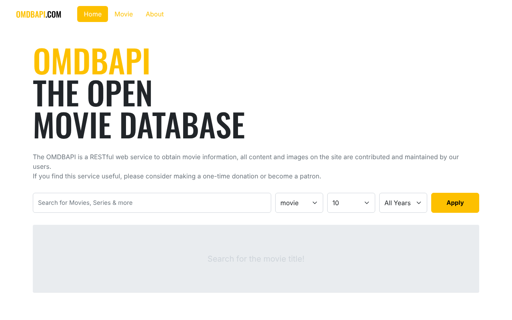

# 🎬 Vue3 Movie App

OMDb API로 영화·시리즈를 검색하고 상세 정보를 볼 수 있는 Vue 3 SPA입니다.

**🔗 라이브 데모:** https://ikyoon0619.github.io/vue3-movie-app/



## 프로젝트 개요

| 항목 | 내용 |
| --- | --- |
| 개발 기간 | 2023.04 ~ 2023.06 |
| 인원 | 1명 (개인 프로젝트) |
| 목적 | Vue 3 컴포넌트 설계, 상태 관리(Vuex), 라우팅, 외부 REST API 연동 학습 |

## 기술 스택

- **Framework**: Vue 3 (Composition API `<script setup>` + Options API 혼용)
- **상태 관리**: Vuex 4 (모듈 분리: `movie`, `about`)
- **라우팅**: Vue Router 4 (Hash History)
- **HTTP**: Axios
- **UI**: Bootstrap 5, SCSS
- **빌드**: Vite 4
- **배포**: GitHub Actions → GitHub Pages
- **코드 품질**: ESLint, Prettier

## 주요 기능

- **영화 검색**: 제목 + 타입(movie / series / episode) + 개수(10/20/30) + 연도 필터
- **상세 페이지**: 포스터, 줄거리, 평점, 감독·배우 등 상세 정보 (`/movie/:id`)
- **로딩 UX**: 검색 중 로더, 상세 페이지 스켈레톤 UI, 포스터 이미지 로딩 표시
- **About 페이지**: 개발자 소개

## 화면 구성

```
App.vue
├── Header (Logo, 네비게이션)
├── RouterView
│   ├── HomeView   : HeadLine + Search + MovieList(MovieItem)
│   ├── MovieView  : 상세 정보 + 스켈레톤 UI
│   └── AboutView  : 개발자 소개
└── Footer
```

## 구현하면서 고민한 점

### 1. 한 번에 10개만 주는 API로 20·30개 결과 보여주기
OMDb 검색 API는 요청 한 번에 10개씩만 결과를 돌려줍니다.
첫 요청 응답의 `totalResults`로 전체 페이지 수를 계산하고, 사용자가 고른 개수만큼만
다음 페이지를 이어서 요청해 결과를 합쳤습니다. (`src/store/movie.js`의 `searchMovies`)

### 2. 이미지가 늦게 뜨는 문제
포스터 이미지가 늦게 로드되면 빈 영역이 보이는 문제가 있었습니다.
이미지를 미리 로드하고 `load` 이벤트를 Promise로 기다리는 `$loadImage` 플러그인을 만들어,
로드가 끝날 때까지 로더를 보여주도록 했습니다. (`src/plugins/loadImage.js`)
상세 페이지에서는 포스터 URL의 `SX300`을 `SX700`으로 바꿔 더 큰 해상도 이미지를 사용합니다.

### 3. 중복 요청 방지
검색 중에 버튼을 여러 번 누르면 요청이 중복되는 문제가 있어,
Vuex 상태의 `loading` 값으로 진행 중인 요청이 있으면 새 요청을 막았습니다.

## 실행 방법

```bash
npm install
npm run dev       # http://localhost:5173
npm run build     # dist/ 에 프로덕션 빌드
npm run preview   # 빌드 결과 미리보기
```

## 배포

`main` 브랜치에 push 하면 GitHub Actions(`.github/workflows/deploy.yml`)가 빌드 후 GitHub Pages에 배포합니다.
GitHub Pages는 `/<저장소 이름>/` 경로로 서비스되므로 빌드할 때 `BASE_PATH` 환경 변수로 경로를 지정합니다.
